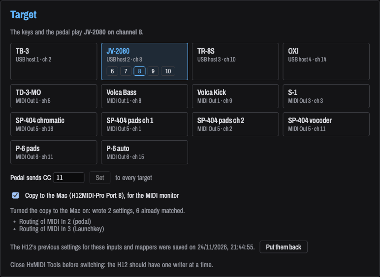
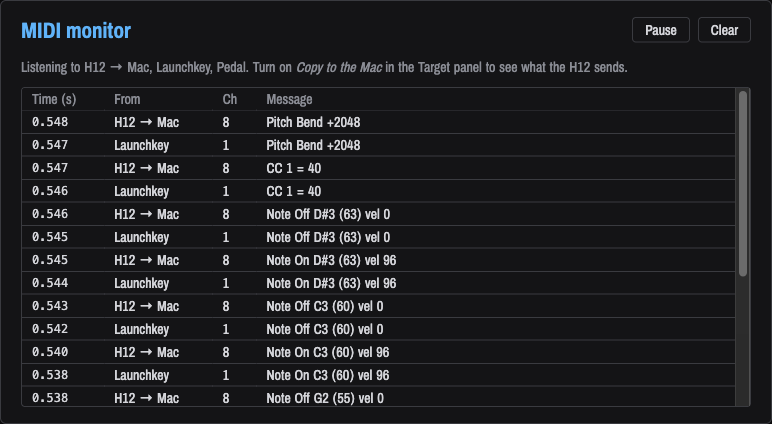

# H12 Target Switcher

Picks one target synth for the Launchkey 49 Mk4 and the DOREMIDI pedal by writing routing and mapper settings to the
CME H12MIDI Pro over SysEx. Requirements: [docs/h12-spec.md](../../docs/h12-spec.md).

So far the app has a **read-only check** of the H12, **target switching** (the only part that writes to the H12), a
**MIDI monitor** and a **clock forwarder** for the Launchkey's arpeggiator.

## Read-only check

On start-up, and whenever the H12's ports come or go, the app:

1. sends the serial-and-firmware status request (`F0 00 20 63 0F 26 01 00 01 F7`) to each `H12MIDI-Pro` output in
   turn, Port 1 first, and stops at the first one that answers;
2. shows that port, the firmware (warning below 4.7) and the serial number;
3. reads the current preset (setting 4) and warns unless it is preset 1;
4. lists every problem: no answer, an error answer from the H12, or an answer with a wrong checksum.

It never writes a setting or sends an action. After power-up the H12's ports appear a few seconds before it answers
SysEx, so when no port answers the app asks again every 2 seconds, up to 5 times in all, before saying so.

## Target switching

One button per target in [src/targets.json](src/targets.json) (output port index, channel 1–16).
A target can list `channels` to choose from, as the JV-2080 does for its parts 6–10: small channel buttons under it.
The lit one is the target the H12 is set to now, worked out by reading its settings back. Clicking another:



1. reads the routing of MIDI In 2 (pedal) and MIDI In 3 (Launchkey) and mappers 18–23;
2. the first time ever, keeps those values as a backup, so **Put them back** can restore them;
3. refuses unless the H12 is on preset 1;
4. writes only the settings that differ, each read back before the next, and stops at the first problem (an error
   answer, no answer, a bad checksum, or a value that reads back differently).

The H12 must be on firmware 4.x: on 5.0 or later the app doesn't switch, as 5.0 stores mappers differently (see
*CME's answers* below). The Launchkey's input is routed to the target's output only, and mappers 18–22 turn its channel 1 (Note On, Note Off,
CC, Pitch Bend, Channel AT) into the target's channel. The pedal follows the keys and mapper 23 turns its CC 11 on
channel 1 into the **pedal CC** on the target's channel. For now that is one CC for every target, set under the target
buttons (11, expression, at first): **Set** rewrites mapper 23 for the current target, and a switch keeps it. The app
reads it back from mapper 23, so it survives a restart. Nothing else on the
H12 is ever written: `core/switcher.ts` refuses any other setting. The backup is kept in the app's local storage
(separately for `npm run dev:h12` and a packaged build).

## MIDI monitor

**Copy to the Mac** (Target panel) also routes the Launchkey's and the pedal's inputs to USB-C virtual cable 8
(`H12MIDI-Pro Port 8`, which nothing else uses and which has no filters), so the Mac gets what the target gets,
after the mappers. Switching target keeps it on or off. The **MIDI monitor** panel logs, newest first:

- **H12 → Mac**: that copy;
- **Launchkey**: what the keys play, from the Launchkey's own USB port;
- **Pedal**: what the pedal converter sends, from its own USB port;
- **App**: each target switch and its result, so a switch can be read against the channels before and after it.



Clock and active sensing are left out. Turn the copy off when you're done: Ableton or another app
listening on Port 8 would get the notes too.

## Launchkey clock

The Launchkey has no MIDI input, so the H12 can't clock its arpeggiator. While the app runs, it forwards clock, Start,
Stop and Continue from `Nome II Clock` to `Launchkey MK4 49 MIDI In` (never its DAW port), each message as it
arrives; nothing else is forwarded, and nothing from the Launchkey's own ports goes back to it. There's no switch: it
pauses while either port is missing and resumes when it's back. The **Launchkey clock** panel shows both ports and the
Nome II's tempo. Keep Ableton's Sync off for the Launchkey's ports, so it gets one clock only.

```bash
npm run dev:h12        # Vite dev server + Electron window
npm run test:e2e:h12   # Playwright against a fake H12 (real MIDI refused)
npm run test:h12       # the read-only check against the real H12
npm run readme:shots -w @synth-editors/h12   # retake the README screenshots against the fake H12
```

## Findings on the real H12 (firmware 4.7, 2026-11-16)

- **SysEx port:** `H12MIDI-Pro Port 1` (USB-C virtual cable 1) answers; the answer comes back on input Port 1. As
  the app stops at the first answer, the other lanes never get the request.
- **Firmware** 4.7; current preset 1 (Main).
- **Answer flags:** answers can have bit 4 of the command byte set as well as bit 6 (`0x51` for a status answer).
  CME says to ignore the high bits; the parser keeps only the low four.
- **Status 0x02 (USB device on a port) can't be used.** Whatever index is asked for, the answer has port 0 in byte 9,
  and its payload looks like raw memory (`64 0B 00 20` = 0x20000B64). Answers come doubled or truncated.
- **Host ports, checked in HxMIDI Tools instead:** U6MIDI Pro-1/2/3 are on host ports 1/2/3 (indices 0/1/2) and
  OXI ONE MKII-1/2/3 on 4/5/6 (indices 3/4/5), inputs and outputs alike, as the spec's target table assumes. All six
  are reserved, so the numbers don't depend on the order the devices are found. CME's page calls these "USB-A
  host ports"; the sockets are USB-C and HxMIDI Tools calls them "USB-C Host".

- **Before the first switch** (read 2026-11-16): mappers 0–23 all hold the factory value, with no inputs enabled
  (words 4 and 5 zero): `7F007F00 7F007F00 00F00F0F 5A000187 0 0`. Word 3's top byte is 5A, firmware 4.x's init
  byte (see *CME's answers* below). The
  Launchkey's input (26) was routed to `2500000F` (U6MIDI Pro 1–3, OXI-1, MIDI Out 1, 3 and 6) and the pedal's (25)
  nowhere.

- **Mapper inputs:** CME's page puts the MIDI inputs in word 5 bits 16–21. The H12 doesn't read those: the first
  switch stored the mappers, but HxMIDI Tools showed them with no input, and the keys stayed on channel 1. Selecting
  MIDI In 3 on one of them in HxMIDI Tools changed word 5 from `00040000` to `04000000`, and nothing else. So the
  MIDI inputs are bits 24–29, the same numbering as the port index. CME confirmed it (below).

- **CME's answers to our report** (2026-11-19; their page is now version 1.1):
  - Word 5: MIDI In n = bit 16 + number of cables + n − 1, so bits 24–29 on the H12's 8 cables, on every firmware.
    Bits 0–7 are USB-C cables 1–8; in word 4, bit n is USB-C host port n + 1.
  - Status 0x02 is a firmware bug (the record isn't copied into the answer), to be fixed. Until then, the connected
    devices come from the reports: after Start reports (action 0x06) the H12 sends one record per connected device,
    then one per connection and disconnection.
  - **Word 3 depends on the firmware.** Before 5.0 the init flag is the whole top byte, 5A; from 5.0 it is 5 in
    bits 26–24 with bits 31–27 written 0. On 4.x, **if any mapper lacks 5A at power-up, the H12 resets every setting
    to factory defaults.** The app wrote flag 5 until 2026-11-19; it now writes 5A, refuses a mapper without it, and
    won't switch targets on firmware 5.0 or later (5.0 is in beta; the H12 stays on 4.7).
  - **It had already happened.** On 2026-11-19, after a power cycle, the H12 read factory values: MIDI In 2 routed to
    `0002FFFF` and MIDI In 3 to `0004FFFF` (every host port plus their own cable), and mappers 18–23 back to the
    factory value. Everything set up in HxMIDI Tools had gone with them, not only what the app wrote.

## Findings on the Launchkey 49 Mk4 (2026-11-16)

- **The arpeggiator follows clock sent to its USB MIDI port** (`Launchkey MK4 49 MIDI In`), both generated by the
  app (a test since removed) and forwarded from the Nome II: changing the tempo changes the arpeggio rate. Forwarding through Web MIDI in the
  renderer sounded fine, so a native MIDI library isn't needed so far.
- **Start (`FA`) restarts the arpeggio** from its first step, so forwarding Start keeps it in phase with the Nome II.
- **Stop (`FC`) doesn't stop it**: the arpeggio runs while keys are held, whatever the transport. That is expected.
