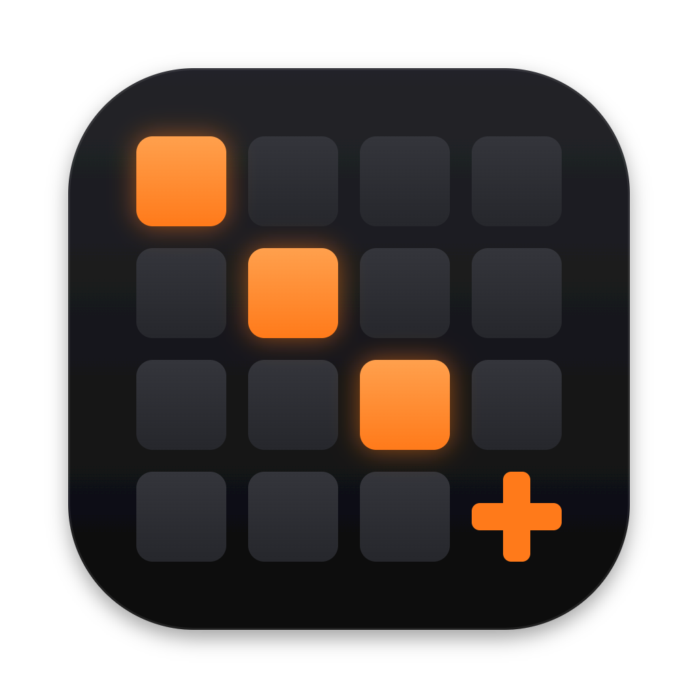

# SP40MORE



SP40MORE is an editor for the Roland SP-404 MK2's effects and pad mixer:
- all 46 effects on the five buses, with presets, scenes and morph, over USB MIDI;
- a pad mixer over the SP-404's USB serial link;
- scopes from its USB audio;
- the Launchpad Pro, BCR2000 and Launchkey controllers, and CC learn.

The [user guide](docs/user-guide.md) explains every feature, with screen grabs.

## Installing

Download the installer for your computer from the
[releases page](https://github.com/bcmodular/synth-editors/releases) (tags `sp404-v…`):

| Computer | File |
| --- | --- |
| Mac with Apple Silicon (M1 and later) | `SP40MORE-<version>-mac-arm64.dmg` |
| Mac with an Intel processor | `SP40MORE-<version>-mac-x64.dmg` |
| Windows 10 or 11 (64-bit) | `SP40MORE-<version>-win-x64.exe` |

The apps aren't signed, so the first launch needs one extra step:

- **Mac**: open the `.dmg` and drag SP40MORE to Applications. The first time you open it, macOS says it
  can't check the app for malicious software. Click **Done**, then go to **System Settings → Privacy & Security**,
  scroll down and click **Open Anyway** next to SP40MORE. macOS then asks for the microphone (for the
  scopes, which listen to the SP-404's USB audio). It may also ask for Bluetooth while the app looks for the
  SP-404's serial port; saying no is fine.
- **Windows**: run the `.exe`. If SmartScreen says "Windows protected your PC", click **More info**, then **Run
  anyway**. The SP-404 needs Roland's driver for its USB audio. Windows lets only one app at a time use a MIDI
  port, so close anything else using the SP-404's first. The Windows build is untested.

## Releasing

```bash
npm run package:sp404                                     # this computer's installers, in apps/sp404/release/
SP404_RELEASE_DIR=/tmp/sp404-release npm run package:sp404  # if Documents syncs with iCloud (see below)
npm run package:sp404 -- --win                            # on a Mac, the Windows installer too
```

From a Mac this builds both `.dmg`s. The Mac apps are ad-hoc signed, which Apple Silicon needs before it will run
them at all. Codesign fails inside a Documents folder that syncs with iCloud, so build somewhere else with
`SP404_RELEASE_DIR`. Signing with a Developer ID (and notarising) needs Apple's certificate, which isn't set up.

For a release, bump `version` in `apps/sp404/package.json`, then push a tag:

```bash
git tag sp404-v0.1.0
git push origin sp404-v0.1.0
```

GitHub Actions (`.github/workflows/sp404-release.yml`) builds the Mac and Windows installers and attaches them to a
draft release; check it on the releases page and publish it.

## App icon

The icon is drawn in `build/icon.svg`: the SP-404's 4×4 pads, a diagonal lit in its button orange, ending in a "+".
After editing it, run `npx electron scripts/icon.cjs` in `apps/sp404` to render `build/icon.png` (electron-builder
makes the Windows `.ico` from it), `build/icon.icns` (macOS) and `public/icon.png` (the window icon, and the Dock icon
in development).

## User guide screen grabs

`npm run guide:shots -w @synth-editors/sp404` retakes the pictures in `docs/images/` against the fake SP-404.
