# SP-404 MK2 Editor user guide

SP-404 MK2 Editor plays and edits the SP-404 MK2's effects and mixes its pads from the computer. The top half is the
five effect buses: every effect has its own module with a drawing you can drag, eight presets per effect per bus,
and 16 FX scenes that recall all five buses at once. The bottom half is a mixer for the pads in the current project,
with level, pan, routing, mute group and envelope for each one, and scopes of what the SP-404 plays.

The editor is still being built. There's no installer yet: run it from the source with `npm run dev:sp404` (see the
[README](../../../README.md)). It hasn't all been tried on the device yet, so check what you hear.

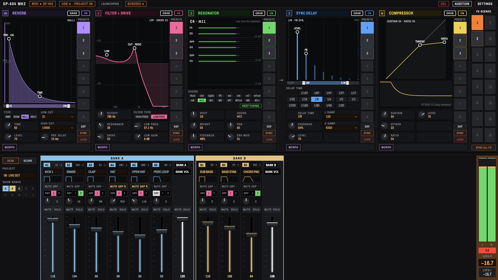

The window is drawn at 1920 × 1080 and scales to fit, so make it any size you like. The pictures in this guide are
the size they are in a full-size window.

Keys are given for the Mac.

## Getting started

1. Connect the SP-404 to the computer by USB and open the editor.
2. The effects use the SP-404's USB MIDI, which the editor finds by itself: the **MIDI** pill in the top bar
   lights and reads **SP-404**.
3. The pad mixer uses the SP-404's USB serial port. The first time, click **CONNECT USB** in the top bar and pick the
   SP-404 in the list. After that the editor connects by itself, at launch and when the SP-404 is plugged back in.
   The **USB** pill shows the project number once it's connected, and the mixer fills with the project's pads.
4. On the SP-404, under **System › MIDI**, set **SEQ Note Out** and **PAD Note Out** to ON, so the editor sees which
   pads play. Then open **SETTINGS** in the editor and set **PAD MIDI** to match the SP-404's MIDI mode (see
   [Settings](#settings)).
5. The level meter listens to the SP-404's USB audio. macOS asks once for permission to use it as a microphone.

The SP-404 doesn't report its effects, so the editor's effects are the truth: what you see is what it last sent.
After switching the SP-404 off and on, press **SYNC ALL FX** to send everything again.

## Top bar

From the left:

- **MIDI**: lit when the SP-404's USB MIDI is connected. **NO PAD NOTES IN** beside it means the editor can send to
  the SP-404 but isn't hearing its notes, so the pad lights fall back on what the serial port reports (hand hits
  only).
- **USB**: the serial link and the project number. **CONNECT USB** appears while it's off.
- **LAUNCHPAD**: not working yet. The Launchpad Pro is planned.
- **BCR2000**: lit when a Behringer BCR2000 is connected (see [BCR2000](#bcr2000)).
- **DEL** (red) and **AUDITION** (white): modes for the presets and scenes. Each stays on until you press it again.
  See [Presets](#presets).
- **SETTINGS**.

## Effects

The FX row follows the SP-404's signal path: **INPUT FX**, then the pad buses **BUS 1** and **BUS 2**, an arrow,
then the master chain **BUS 3 → BUS 4**. The **FX SCENES** column is on the right.

Each bus has its own colour: INPUT violet, BUS 1 pink, BUS 2 green, BUS 3 blue, BUS 4 yellow. The mixer's routing
buttons use the same pink and green for BUS 1 and BUS 2.

### A module

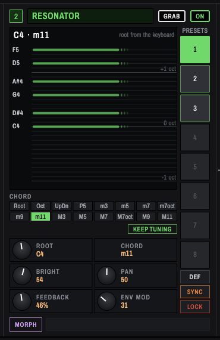

- **Header**: the bus number, the effect's name (click it to choose an effect), **GRAB** and **ON**. ON switches the
  effect on and off.
- **Drawing**: shows what the settings do. The white dots and bars are handles: drag them to change the values they
  show, hold Shift for fine moves, and double-click one to put it back to its start value. The drawings make the
  settings readable; they aren't measurements of the SP-404.
- **Controls**: every parameter also has an ordinary control under the drawing, laid out as the BCR2000's encoders
  are: parameters 1–3 down the left, 4–6 down the right. Drag a knob up or down (Shift for fine), use the scroll
  wheel over it, or double-click it to reset it. Wider controls, such as the note-value buttons for a delay time,
  sit in a row of their own above the grid.
- **SYNC** (on effects with a rate or time) swaps the knob for note values that follow the SP-404's tempo.
- **KEEP TUNING** appears on effects with tuning parameters (Resonator's ROOT and CHORD, Hyper-Reso's NOTE and SCALE,
  and so on), above the first of them. While it's on, recalling a preset leaves those parameters as they are, so a
  preset doesn't change the key.
- Controls drawn in blue are the editor's own, not the SP-404's: Isolator's **KILL LOW / MID / HIGH** drop a band to
  nothing and a second press puts its level back.
- The column on the right holds the eight **PRESETS**, then **DEF**, **SYNC** and **LOCK**, and the bottom row is
  **MORPH**.

Shift + scroll wheel, anywhere in the window, scrolls the mixer's desk sideways, even over a knob or fader.

### Choosing an effect

Click the effect's name to open the chooser.

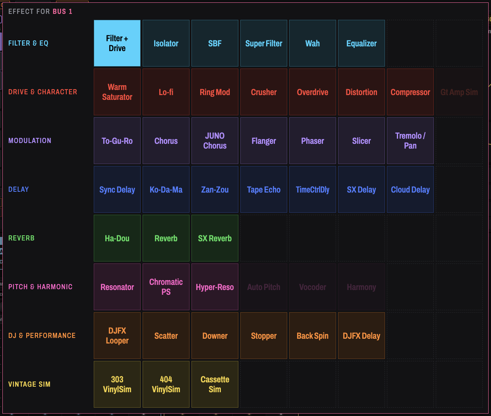

The 46 effects sit in eight rows, one per group, each in its own colour: Filter & EQ, Drive & character,
Modulation, Delay, Reverb, Pitch & harmonic, DJ & performance and Vintage sim. Every effect keeps its place
whichever bus you're choosing for, and the ones that bus can't load are dimmed. The effect that's loaded now is
filled. Click an effect to load it; Escape or a click outside closes the chooser.

Each bus remembers the last values of every effect used on it, so switching back to an effect brings its settings
back.

On BUS 1 and 2, the first five effects are the SP-404's **Direct FX** slots. The editor assumes they hold the factory
effects (Filter + Drive, Resonator, Sync Delay, Isolator, DJFX Looper). If you've reassigned them on the SP-404,
choosing those effects loads whatever is in the slot.

### Presets

Each bus has eight presets for each effect. The column matches a Launchpad column, top to bottom.

- **An empty preset**: press it to store the bus's settings.
- **A stored preset** is outlined in the bus colour: press it to recall it. Only what changed is sent.
- The preset the bus matches right now is **filled**. Change a value and it goes dark.
- **DEF** recalls the effect's defaults (for now, its start values). There's no way to store your own defaults yet.

To replace a preset, delete it and store it again.

**AUDITION** previews instead of recalling. With it on, hold a stored preset (or an FX scene) to hear it; letting go
puts back what was playing. Holding Shift while you press does the same without turning AUDITION on.

**DEL** deletes. With it on, the stored presets and scenes are outlined in red and the bus numbers turn red:

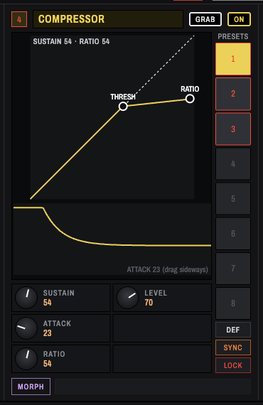

- Press a stored preset or scene to delete it.
- Press a bus number to clear the bus: it unloads the effect and switches it off. Its values stay in the bus's
  memory for next time.

Press DEL again to leave the mode.

### GRAB, SYNC and LOCK

- **GRAB** (beside ON) switches the effect on only while you hold it. Letting go puts ON back as it was.
- **SYNC** sends the bus to the SP-404 again. **SYNC ALL FX**, under the scenes, sends every bus.
- **LOCK** protects a bus while you play. The drawing gets a red edge.

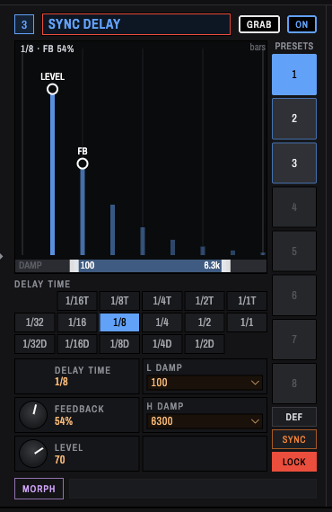

While a bus is locked, its presets, DEF, morph and ON still work, but storing, deleting, clearing and FX scene recall
leave it alone. Storing a scene still includes it. Locks are remembered between runs.

### Morph

Morph blends a bus from where it is towards a stored preset. It's experimental.

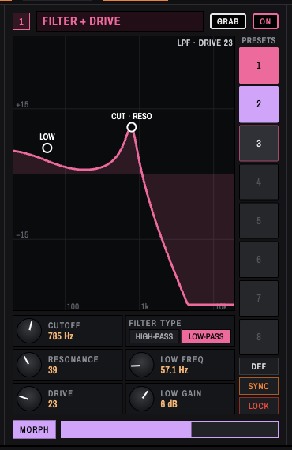

1. Press **MORPH**. It lights in lilac.
2. Press a stored preset. It becomes the target, filled in lilac, and the blend starts from the bus's values at that
   moment.
3. Drag the track (or use the scroll wheel over it) to set how far to go, from 0 to 100%. Switch-type parameters
   jump at the halfway point; the rest move smoothly.
4. Press **MORPH** again to finish. The bus keeps the blended values.

Pressing another stored preset while morph is on picks a new target. Choosing another effect or clearing the bus ends
the morph.

### FX scenes

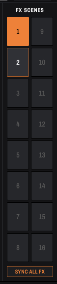

A scene is all five buses at once: their effects, ON, values and SYNC settings. There are 16.

- **An empty scene**: press it to store all five buses.
- **A stored scene**: press it to recall it. Locked buses stay as they are.
- The scene every bus matches right now is filled.

AUDITION, Shift and DEL work on scenes as they do on presets.

### The FX library file

Presets, defaults, the buses' remembered values, KEEP TUNING and the scenes are kept in one file, saved as you go.
On the Mac it's `~/Library/Application Support/@synth-editors/sp404/fx-library.json`. In **SETTINGS › FX LIBRARY**:

- **EXPORT…** saves a copy.
- **IMPORT…** replaces the library with a file you exported, after asking. The buses keep playing what they're
  playing.
- **SHOW FILE** shows the file in the Finder.

## Pad mixer

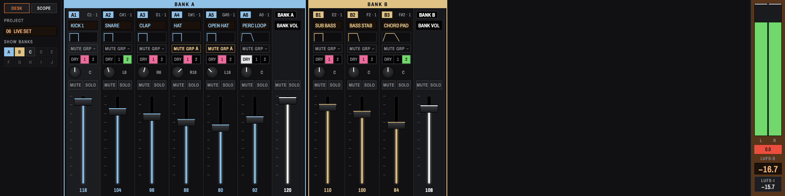

The desk has a strip for each loaded pad in the current project, grouped by bank. Empty pads are hidden. Each bank
ends in a **BANK VOL** fader.

The column on the left has:

- **DESK** and **SCOPE**: swap the desk for the [scopes](#scopes).
- **PROJECT**: the project's number and name. Click the name to rename the project.
- **SHOW BANKS**: which banks the desk shows. Banks with no samples are greyed out. Two banks fit across the window;
  with more, the desk scrolls sideways (Shift + scroll wheel).

### A strip

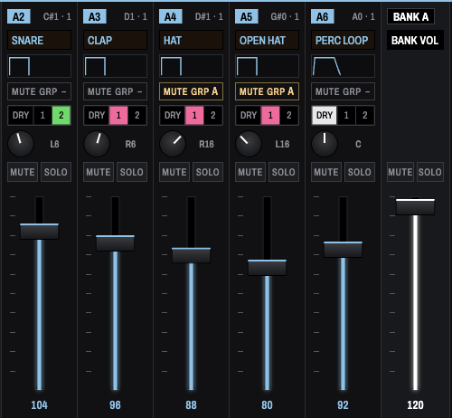

From the top:

- **Pad label** and its MIDI note and channel. The label flashes when the pad plays, and the pad selected on the
  SP-404 is shaded. **Hold the label** (or press Space or Enter on it) to play the pad; letting go stops it, so gated
  and looped pads stop as they do on the device.
- **Sample name**: click it to rename the sample.
- **Envelope**: click it to edit the pad's attack, hold and release.
- **MUTE GRP**: none, or A–J.
- **Routing**: **DRY**, **1** (BUS 1) or **2** (BUS 2).
- **Pan**, from L50 to R50.
- **MUTE** and **SOLO**.
- **Level fader** and value (0–127).

The SP-404 has no pad mute, so **MUTE** sets the level to 0 and a second press puts the level back. While a pad is
silenced, its level shows in brackets. **SOLO** silences every pad that isn't soloed, across the project. A bank's
MUTE and SOLO work the same way on whole banks.

### Envelope

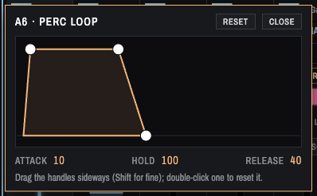

Drag the handles sideways for attack, hold and release (Shift for fine); double-click one to reset it. **RESET** puts
all three back (attack 0, hold 100, release 0).

## Scopes

The **meter** on the right of the mixer is always on. It shows the SP-404's USB audio: the master out, after BUS 3
and BUS 4 and after the VOLUME knob. So it reads lower when VOLUME is turned down; it's the USB level, not the
SP-404's headroom.

- **L** and **R** peak bars, amber near full scale.
- The **clip light** under them shows the highest peak since you last clicked it. Click to clear it.
- **LUFS-S**: short-term loudness over the last 3 seconds.
- **LUFS-I**: integrated loudness since you last clicked it. Click to start again.

**SCOPE**, at the top of the mixer's left column, swaps the desk for the scope view:

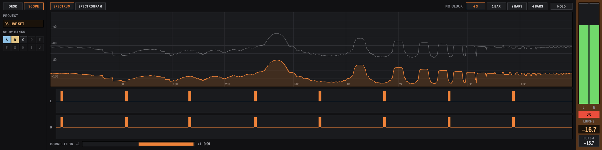

- **SPECTRUM**: 20 Hz to 20 kHz, with a falling peak line. It's tilted +4.5 dB per octave, so a typical mix reads
  roughly flat.
- **SPECTROGRAM**: the same frequencies, bottom to top, scrolling over time and lined up with the waveforms below.

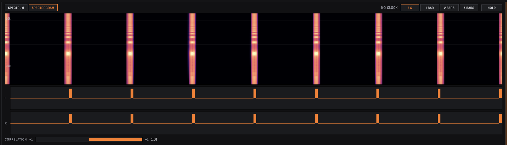

- **L** and **R** waveforms, newest on the right.
- **4 S**, **1 BAR**, **2 BARS**, **4 BARS**: how much the waveforms and spectrogram show. Bars follow the MIDI clock's
  tempo, shown beside them; with no clock it's 4 seconds.
- **HOLD** freezes the picture; the meter keeps running.
- **CORRELATION**: from −1 to +1. Near +1 is close to mono; below 0 (amber) the channels cancel when summed.

The view and the choices are remembered.

## Settings

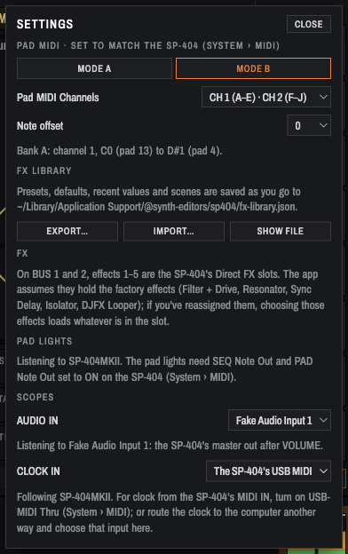

- **PAD MIDI**: set this to match the SP-404's MIDI mode (System › MIDI). The SP-404 doesn't report it, and the
  editor needs it for the pads' MIDI notes, the pad lights and playing pads from the strip. In **MODE B**, also set
  **Pad MIDI Channels** and **Note offset**. The line below says where bank A's pads land, to check against the
  SP-404.
- **FX LIBRARY**: see [The FX library file](#the-fx-library-file).
- **PAD LIGHTS**: which input the editor hears the pads on.
- **SCOPES**: **AUDIO IN** is the input for the meter and scopes (the first SP-404 input unless you pick another).
  **CLOCK IN** is the MIDI input for the tempo. For a clock that reaches the SP-404's MIDI IN, turn on **USB-MIDI
  Thru** on the SP-404 (System › MIDI), or route the clock to the computer another way and pick that input here.

## BCR2000

A Behringer BCR2000 controls the six parameters of each effect, using the SP-404 TouchOSC layout's BCR preset
(`SP404-mk2-BCR2000.syx`, loaded into the BCR with BC Manager). Connect it by USB; any MIDI port with BCR2000 in its
name is used.

- Each bus takes two columns of encoders: BUS 1 is columns 1–2, BUS 2 columns 3–4, BUS 3 columns 5–6 and BUS 4
  columns 7–8. INPUT FX is on columns 1–2 of the BCR's second preset (*SP404 TouchOSC (Ch10)*).
- The three rows of encoders under the buttons match the module's controls: parameters 1–3 down the left column,
  4–6 down the right.
- The left top encoder sets the bus's morph amount, once morph is on and has a target.
- The encoder rings follow the editor: preset and scene recall, DEF, morph and changes on the screen all move them.
- The BCR's buttons do nothing.

With one BCR, switch it to its second preset to reach INPUT FX. The first turn after switching doesn't jump.

## Between sessions

The editor remembers:

- the FX library: presets, defaults, each bus's remembered values, KEEP TUNING and the scenes;
- what each bus was playing;
- LOCK on each bus;
- the banks shown for each project, DESK or SCOPE, and the scope's choices;
- the settings.

The pads' levels, pans and so on live in the SP-404's project, and the editor reads them when it connects.
