# TB-3 Editor user guide

TB-3 Editor is an editor and patch librarian for the Roland TB-3. It shows every tone parameter
on one screen and sends changes to the TB-3 as you make them. It keeps sets of 16 patches and a
library of patch files on your computer. You can audition any patch without losing your edits,
and it has an undo history.

To install it, see the [README](../README.md).

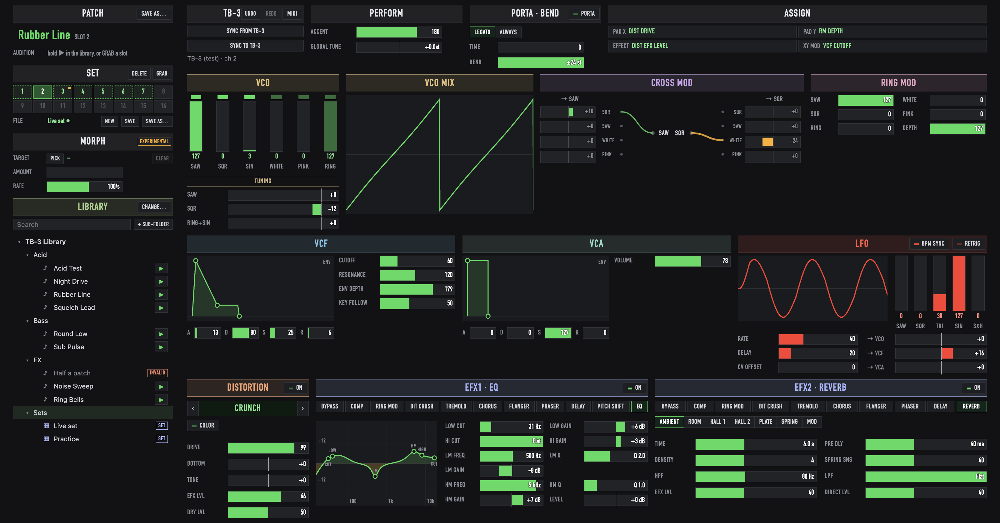

The sidebar on the left handles patches: the **PATCH** being edited, the **SET** of 16 slots,
**MORPH** and the **LIBRARY**. The rest of the window is the sound itself. The top strip has the
TB-3 connection, performance controls and the pad assignments. Below it, the rows follow the
signal path: oscillators, then filter, amp and LFO, then the effects.

The layout scales to fit the window, so make the window any size you like.

Keys are given for the Mac. On Windows, use Ctrl for ⌘ and Alt for Option.

## Getting started

1. Connect the TB-3 by USB, either directly or through a MIDI interface, and open TB-3 Editor.
2. Click **MIDI** in the TB-3 block. Set **TB-3 IN** and **TB-3 OUT** to the TB-3's ports. When
   the TB-3 is connected directly, both are called TB-3. Set **TB-3 CHANNEL** to the TB-3's MIDI
   channel. Only GLOBAL TUNE uses the channel; everything else works on any channel.
3. Click **SYNC FROM TB-3**. The editor reads the sound the TB-3 is playing and shows it.
4. Click **CHOOSE…** in the LIBRARY block and pick a folder for your patches and sets. It can
   be an empty folder, or one that already holds `.syx` patch files.

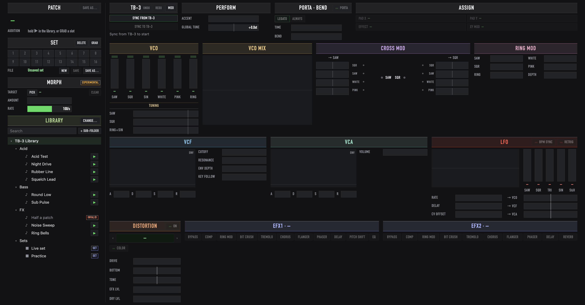

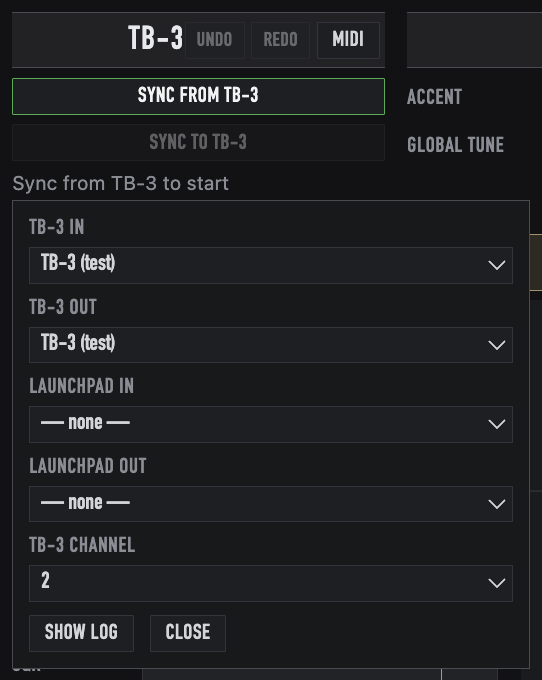

On Windows, a MIDI port can only be used by one app at a time. Close anything else that is using
the TB-3's port, such as a DAW or MIDI-OX, before you start.

The ports, channel and library folder are remembered.

**SHOW LOG** in the MIDI settings lists the messages going to and from the TB-3, which helps when
something isn't getting through. The LAUNCHPAD ports are for Launchpad support in a later version
and don't do anything yet.

## Editing the sound

Every change is sent to the TB-3 straight away, so you hear it as you edit.

### Faders

All the values are faders:

- **Drag** a fader to change it. The drag is relative: grab anywhere and move.
- Hold **Shift** while dragging for fine control.
- **Scroll** over a fader to step its value one at a time.
- **Double-click** a fader to reset it to zero, its centre, or its default for effect settings.

Faders with a centre line, like the tunings and cross mod, are bipolar: they fill outwards from
the middle. Each fader shows its value in the TB-3's own units (semitones, Hz, dB, ms, note
lengths and so on).

### Top strip

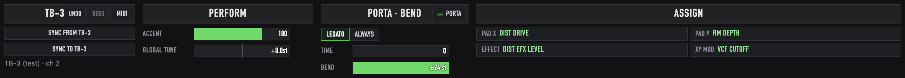

- **TB-3**: SYNC FROM TB-3 reads the TB-3's current sound into the editor. SYNC TO TB-3 sends the
  whole patch in the editor to the TB-3, in case the two get out of step. The line underneath
  shows the port and channel. UNDO and REDO are covered in [Undo](#undo).
- **PERFORM**: ACCENT is part of the patch. GLOBAL TUNE tunes the whole TB-3. It isn't saved
  with patches and only works while the TB-3 is connected.
- **PORTA · BEND**: portamento on/off, LEGATO or ALWAYS, glide time and bend range.
- **ASSIGN**: which parameter the TB-3's pad X and Y axes, EFFECT knob and XY MOD control in this
  patch.

### Assigning the pads and EFFECT knob

To change an assignment, click its button in ASSIGN (PAD X, PAD Y, EFFECT or XY MOD). Every
parameter that can be assigned gets a dotted outline. Click the one you want; Esc cancels.

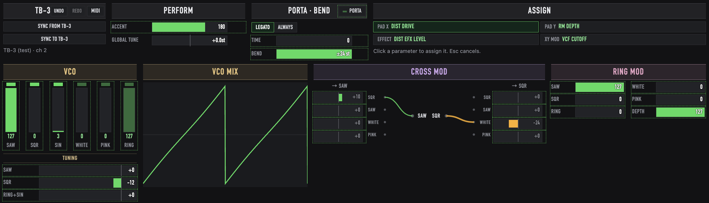

### Oscillators

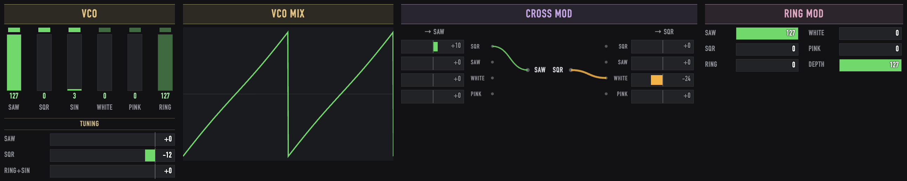

- **VCO**: a level fader for each source: saw, square, sine, white and pink noise, and the ring
  modulator. The little light above each fader switches that source on and off. TUNING sets the
  pitch offsets of the saw, square, and ring + sine oscillators.
- **VCO MIX**: a picture of the mixed waveform. It is drawn from the settings to show the shape
  of the mix, not measured from the TB-3's output.
- **CROSS MOD**: how much the square, saw and noise sources modulate the saw (left column) and
  the square (right column). The diagram in the middle shows which paths are active: green for
  positive amounts, amber for negative ones.
- **RING MOD**: the ring modulator's source depths and overall depth.

### Filter, amp and LFO

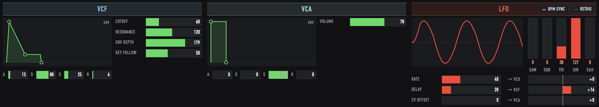

- **VCF**: cutoff, resonance, envelope depth and key follow, with the filter envelope. Drag the
  envelope's handles to shape it. The first sets attack, the second sets decay (sideways) and
  sustain (up and down), and the last sets release. The A, D, S and R faders underneath edit the
  same values.
- **VCA**: the amp envelope, edited in the same way, and the master volume.
- **LFO**: the waveform mix (saw, square, triangle, sine and sample & hold), rate, delay and CV
  offset, and how much the LFO moves the VCO, VCF and VCA. BPM SYNC locks the rate to the tempo,
  and RETRIG restarts the LFO on each note. The picture shows the resulting shape.

### Distortion and effects

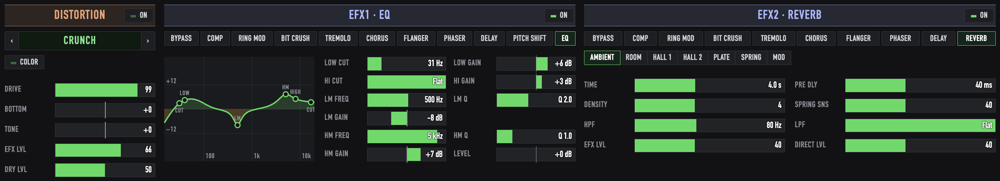

- **DISTORTION**: ON switches it in. Step through the 25 types with ‹ and ›, by scrolling, or with
  the arrow keys. To see every type grouped by family, click the type's name. COLOR is the TB-3's
  distortion COLOR switch.

  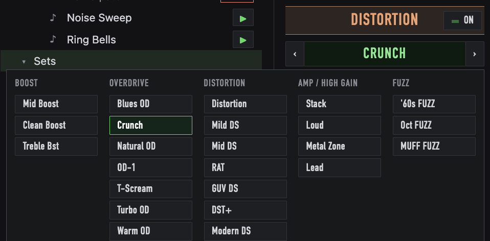

- **EFX1 and EFX2**: pick the effect type from the row of buttons. ON switches the effect in.
  The settings below change with the type; some types also have mode buttons, like the reverb's
  AMBIENT, ROOM and HALL. Settings that the current mode doesn't use are dimmed.
- **EQ** (EFX1 only) shows its frequency response, with a handle for each band:
  - Drag a handle sideways to change its frequency, or up and down to change its gain.
  - Scroll over a mid band's handle to change its width (Q).
  - Double-click a handle to reset it.

## Patches and sets

### The patch you're editing

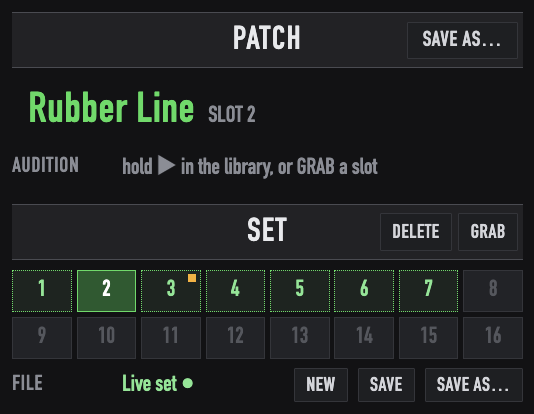

The **PATCH** block names the patch in the editor and where it lives: a slot of the set (SLOT 2
here), or NOT IN SET. A **●** after the name means it has edits that aren't saved yet.
**SAVE AS…** writes the patch to a `.syx` file in your library.

The **AUDITION** line underneath names the patch you're auditioning while you hold ▶ in the
library or GRAB a slot. It also shows the prompts for the DELETE, GRAB and morph target modes.

### Sets and slots

A **set** is 16 slots, each holding a patch and a name. A set is saved as one `.tb3set` file.
Each slot keeps its own copy of the patch, so renaming, moving or deleting library files never
breaks a set.

- **Click a filled slot** to recall it. The editor shows it and the TB-3 plays it. Only the
  parts that differ from the current sound are sent.
- **Click an empty slot** to store the patch in the editor there.
- **Double-click** a slot to rename it.
- **Drag a patch** from the library onto a slot to copy it in. If the slot is full, you're
  asked first.
- **Right-click** a slot for Store or Replace with the patch in the editor, Rename, Save as .syx,
  and Clear.

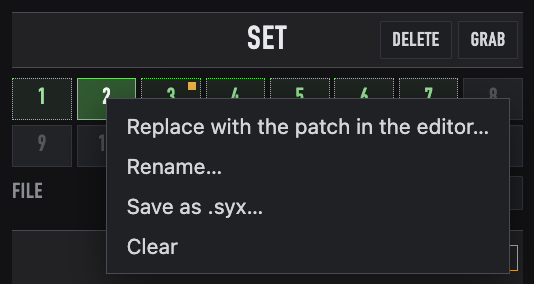

Slot colours:

- **Grey**: empty.
- **Dotted green**: filled.
- **Solid green**: active.
- **Amber corner**: edited since the set was last saved.

Each slot keeps its own edits, so you can move between slots without losing work. Edits are
written to the file when you save the set.

**DELETE** and **GRAB** are modes. Click the button to turn the mode on, and click it again or
press Esc to turn it off.

- **DELETE**: click slots to clear them. There's no question, because you can undo it. The mode
  stays on so you can clear several.

  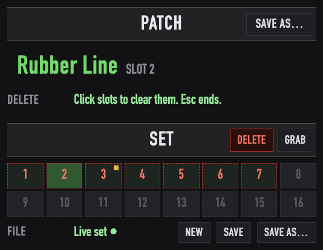

- **GRAB**: hold a slot to audition it. The TB-3 plays it and the editor shows it while you hold;
  when you let go, both go back to the patch you were editing, unsaved edits included. Holding
  Option and pressing a slot does the same without turning the mode on.

  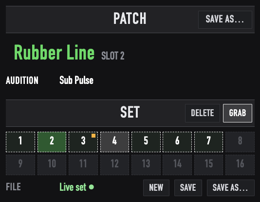

The **FILE** line names the open set, with **●** when it has unsaved changes:

- **NEW** starts an empty set.
- **SAVE** writes the set back to its file.
- **SAVE AS…** asks for a name and a folder.

If you open or start another set while the current one has unsaved changes, you're asked whether
to save them, discard them or cancel.

### Saving files

SAVE AS… for a patch, a slot or a set asks for a name and a folder. The folder starts at the one
selected in the library. If a file with that name already exists, you're asked before it's
replaced.

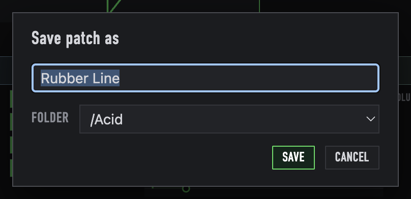

## Library

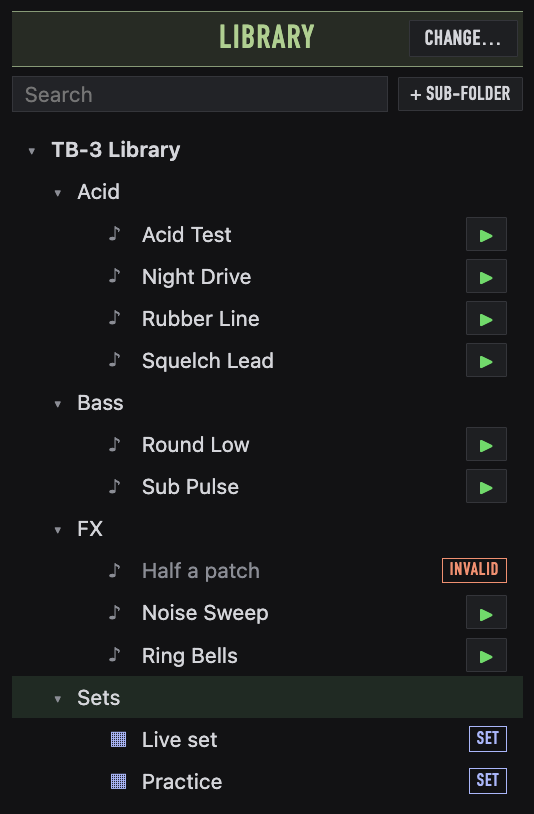

The library is the folder you chose, with its `.syx` patches and `.tb3set` sets in any number of
sub-folders. **CHANGE…** picks a different folder. The tree updates by itself when files change
in Finder or Explorer.

- **Click a folder** to select it: it's where SAVE AS… starts and where **+ SUB-FOLDER** creates
  a folder. Open and close folders with the triangle, or by double-clicking.
- **Hold ▶** on a patch to audition it. The TB-3 plays it and the editor shows it, read only,
  until you let go. Then both return to what you were editing.

  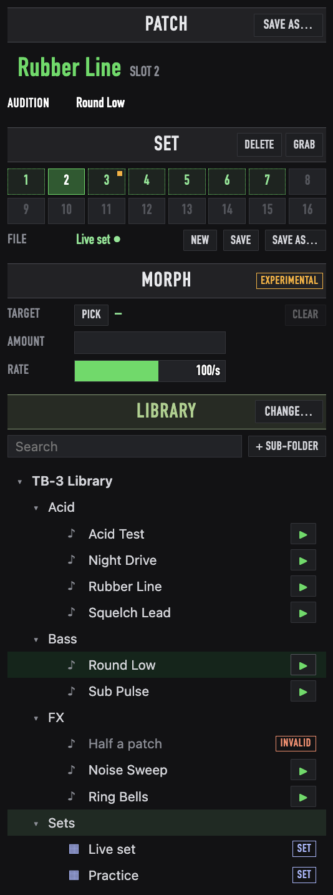

- **Double-click a patch** to load it into the editor without adding it to the set (NOT IN SET).
  To keep it, click an empty slot or use SAVE AS….
- **Double-click a set** to open it.
- **Drag** a patch onto a slot to copy it into the set. Drag a patch, set or folder onto
  another folder to move it there; drop it on the top row to move it to the library folder itself.
- **Hover** over a file to see its path and when it was created and last modified.
- **Search** filters the tree by name as you type.

  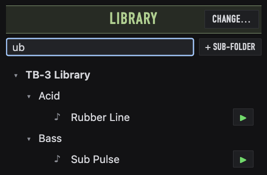

- **Right-click** for Load into editor (patches), Open set (sets) or New folder (folders), plus
  Rename, Move to Trash, and Reveal in Finder (Show in Explorer on Windows).

  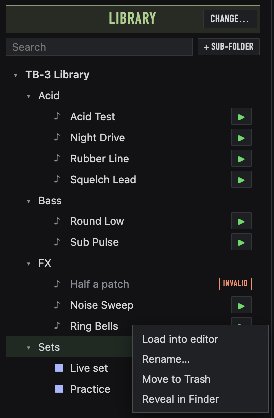

Files that aren't complete TB-3 patches are listed with an **INVALID** badge and can't be loaded;
hover over one to see what's wrong with it. Move to Trash asks first. Get files back from the
Trash or Recycle Bin if you need them.

## Morph

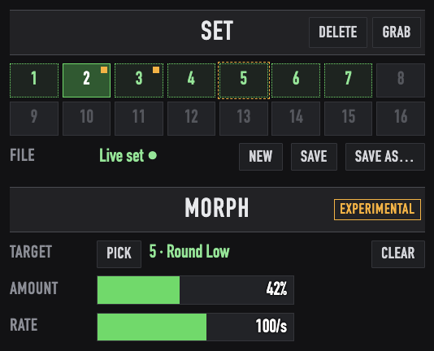

Morph blends the patch in the editor towards another slot.

1. Click **PICK**, then a filled slot. That slot is the target, outlined in amber.
2. Move **AMOUNT** to blend from the patch you started with (0%) to the target (100%). Smooth
   parameters glide. Switches and effect types jump over at the halfway point.
3. **CLEAR** stops morphing and goes back to the patch from before the morph.

To keep a blend, store it in a slot, use SAVE AS…, or edit any control: the blend becomes the
current patch's edits. Picking another target carries on from the current blend.

**RATE** limits how many changes per second are sent to the TB-3 while you move AMOUNT. If the
TB-3 stops playing or falls behind during a morph, turn RATE down.

Morph is **experimental**. A fast move between very different patches can leave some settings on
the TB-3 out of step with the editor. If that happens, click SYNC TO TB-3 to resend the whole
patch.

## Undo

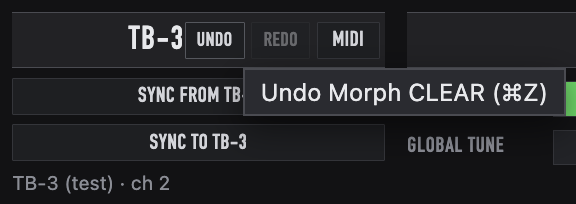

⌘Z undoes and ⇧⌘Z redoes. On Windows, use Ctrl+Z, and Ctrl+Y or Ctrl+Shift+Z. The **UNDO** and
**REDO** buttons in the TB-3 block do the same; hover over one to see what it will undo or redo.

You can undo:

- Parameter edits. One drag or scroll of a control is one step.
- Storing, replacing, renaming and clearing slots.
- Morph CLEAR.
- Renaming files, moving files and new folders in the library.

Undo and redo send the TB-3 just what changed.

Some things can't be undone:

- Recalling a slot, loading a file, SYNC FROM TB-3 and auditioning. These only change which patch
  you're looking at, not the patch itself.
- Move to Trash. Restore the file from the Trash instead.
- Morph AMOUNT moves.

The history holds 100 steps and is cleared when you quit. Opening or starting a set clears the
set and slot steps; library steps stay. While a text box has focus, ⌘Z undoes typing in the box
instead.

## Between sessions

The editor remembers your library folder, the last set you had open and which slot was active.
It also keeps unsaved slot edits, so they're still there next time, still marked as unsaved.

At launch, the editor shows the last set but **doesn't send anything** to the TB-3. Click a slot,
or SYNC TO TB-3, when you want the TB-3 to play what's on screen. Click SYNC FROM TB-3 to start
from the TB-3's own sound instead.

Error messages appear at the bottom of the window. Click one to dismiss it.
