# UI review

A review of the TB-3 and SP-404 editors, one topic at a time. Fonts first; the other topics are listed at the end.

## 1. Fonts

### What is in use today

Neither app bundles a font. Both name macOS system fonts, so what you see depends on the machine.

| Family (as rendered on the Mac) | Weights | Sizes | Where |
| --- | --- | --- | --- |
| **DIN Condensed** (macOS, Linotype; only a Bold exists) | Bold only | TB-3: 10–26px (root 14px). SP-404: 9–22px (root 12px) | Everything on the panels in both apps: section headers, labels, values, buttons, LCD-style readouts (patch name, project, LUFS), SP-404 pads, Launchpad / BCR controls |
| SF Pro (`-apple-system`) | Regular | TB-3: 12–14px | TB-3 status line, library search and rows, tooltips, context menus, dialog text and inputs, toasts |
| SF Pro (`-apple-system`) | Regular | SP-404: 9–10px | Labels drawn inside the SP-404 FX views (`.gl`, `.gt`, `.hl`: "PRE · LVL", "CUT · RESO", axis marks) |
| DIN Condensed, on canvas | Bold | 10px | Spectrum / scope axis labels (`packages/audio/src/spectrumDraw.ts`), both apps |
| `ui-monospace` / Menlo | Regular | 11px | TB-3 MIDI log; SP-404 serial spike page (dev only, also Helvetica Neue) |

The stack `"DIN Condensed", "DIN Alternate", "Avenir Next Condensed", "Helvetica Neue", sans-serif` is written out three
times (both `styles.css` files and `spectrumDraw.ts`). Sizes are set per selector: TB-3 uses 9 sizes, SP-404 uses 15,
including 9, 9.5, 10.5, 11.5 and 12.5px.

### Findings

Screenshots were taken from both apps running against their fake devices. The TB-3 is shown at 2× (the BenQs). The
SP-404 is shown at 1× and full size (1920×1080, zoom 1), which is how it looks on the 1080p iiyama.

1. **The smallest SP-404 text is hard to read at arm's length.** On the 1× monitor, DIN Condensed Bold at 9–10px
   (knob labels `CUTOFF` / `RESONANCE` at 9.5px, `EXP` at 9px, group titles at 10px, `PRESETS`) closes up: the
   counters of B, R and S fill in, and since there is only one weight, the labels can only be set apart from the
   values by colour. Values (12px, orange) read well; the grey labels above them don't.
2. **Mac-only, and it can't be fixed by bundling.** DIN Condensed comes with macOS under Apple's licence and can't be
   redistributed. The TB-3 `package.json` also builds for Windows, where nothing in the stack exists: there the panels
   fall back to Arial, which is about a third wider, so the fixed-size layouts would overflow.
3. **Numbers.** DIN Condensed figures are tabular (every digit is the same width, measured), so the faders and knob
   values don't jitter. SF Pro figures are proportional ("1" is narrower). The TB-3 library rows, status line and
   toasts don't show changing numbers, so it doesn't matter there yet.
4. **Two families side by side in the SP-404 FX views.** The labels drawn inside the graphs are SF Pro 9–10px, while
   everything around them is DIN. Side by side, the graphs look like they belong to another app.
5. **The two apps match, but only by chance.** They use the same family, but the root size differs (14px vs 12px),
   uppercase tracking differs (`.lbl` is 0.04em in the TB-3 and 0.1em in the SP-404), and there are no shared font
   variables or type scale. Most labels are typed in uppercase in the source; only `.lbl` / `.gt` use `text-transform`.
6. **Licensing.** Nothing is bundled today, so there is nothing to license. Any font we bundle must allow
   redistribution in a public repo and in the packaged app. The SIL Open Font License (OFL) does, as long as the
   licence file ships with it.

### Univers and the SP-404's own panel

The SP-404 MK2's panel lettering is said to be Univers or close to it. I couldn't confirm this from Roland's material,
but it would fit: Roland panels use neo-grotesques of this kind, which differ from DIN's road-sign shapes (square
rounds, straight-legged R, flat horizontal stroke ends). Univers itself can't be used here: it is a commercial
Linotype/Monotype font, macOS doesn't include it, and its licences don't let the font files go into a public repo.

So I tried open-licence (SIL OFL) fonts in the same family of designs. Each is on npm as `@fontsource/…`, so it can be
bundled.

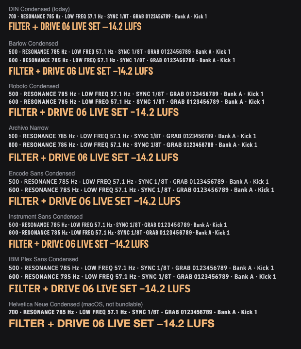

- **Roboto Condensed** (Google, OFL): closest in feel to Univers Condensed. It has the same even strokes, horizontal
  ends and straight-legged R, plus a proper condensed width and weights from 100 to 900. Tabular figures are built in.
- **Archivo Narrow** (Omnibus-Type, OFL): a grotesque that is a little warmer and slightly wider. Its numbers read
  well.
- **Encode Sans Condensed** (OFL): wider and rounder, closer to Helvetica than to Univers. Not taken further.
- **Instrument Sans** at 75% width (OFL, variable): as narrow as DIN, but squeezed: at 9–10px the letters crowd.
  Not taken further.
- **IBM Plex Sans Condensed** (OFL): very legible, but too wide for the layouts (see option D).

### Options

Each sample takes the same piece of each app with the option's fonts injected, so layout problems show up as they
would. Option A keeps today's look, so its sample is "today".

**SP-404 FX (1×, as on the iiyama)**

| Today / A (DIN Condensed) | B: Barlow Condensed | C: Roboto Condensed | C′: Archivo Narrow | D: IBM Plex |
| --- | --- | --- | --- | --- |
| 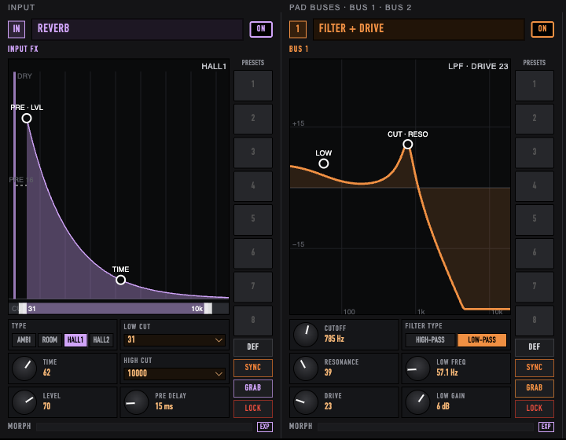 |  | 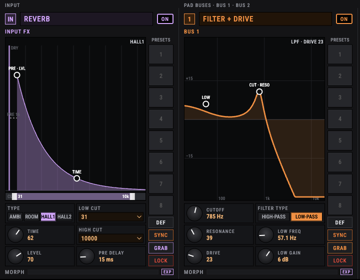 | 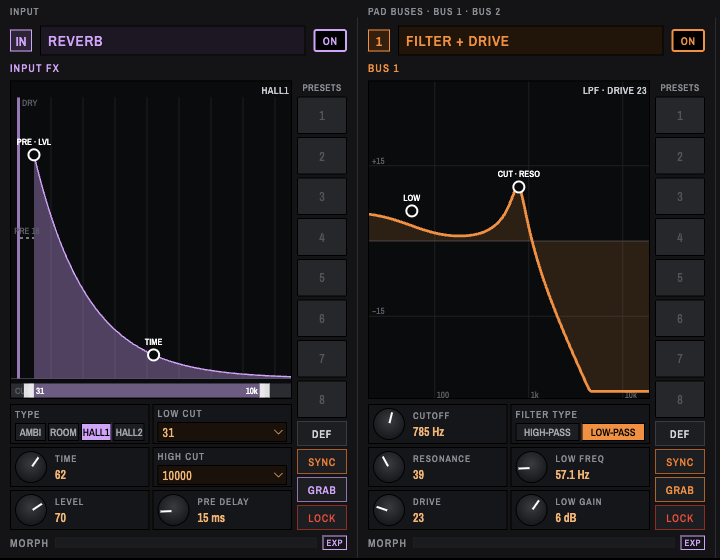 | 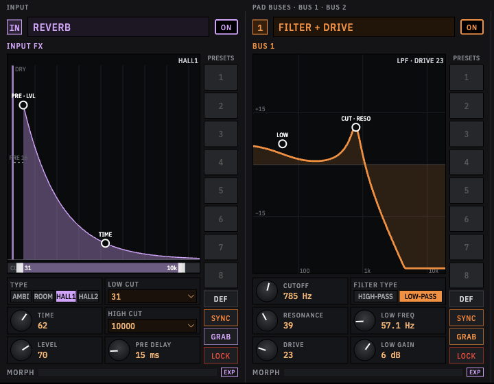 |

**SP-404 mixer (1×)**

| Today / A | B: Barlow Condensed | C: Roboto Condensed | C′: Archivo Narrow | D: IBM Plex |
| --- | --- | --- | --- | --- |
|  | 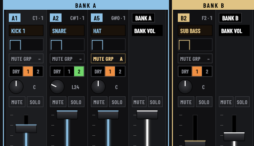 | 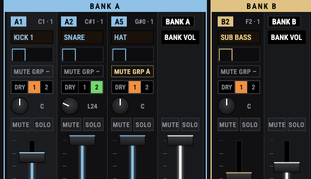 | 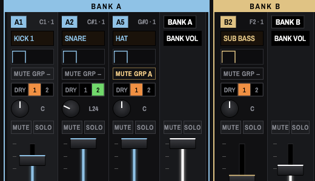 | 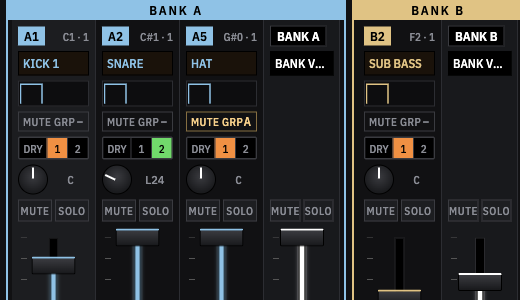 |

**TB-3 (2×)**

| Today / A | B: Barlow Condensed | C: Roboto Condensed | C′: Archivo Narrow | D: IBM Plex |
| --- | --- | --- | --- | --- |
| 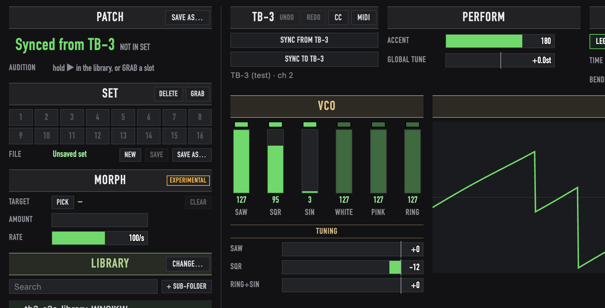 |  |  | 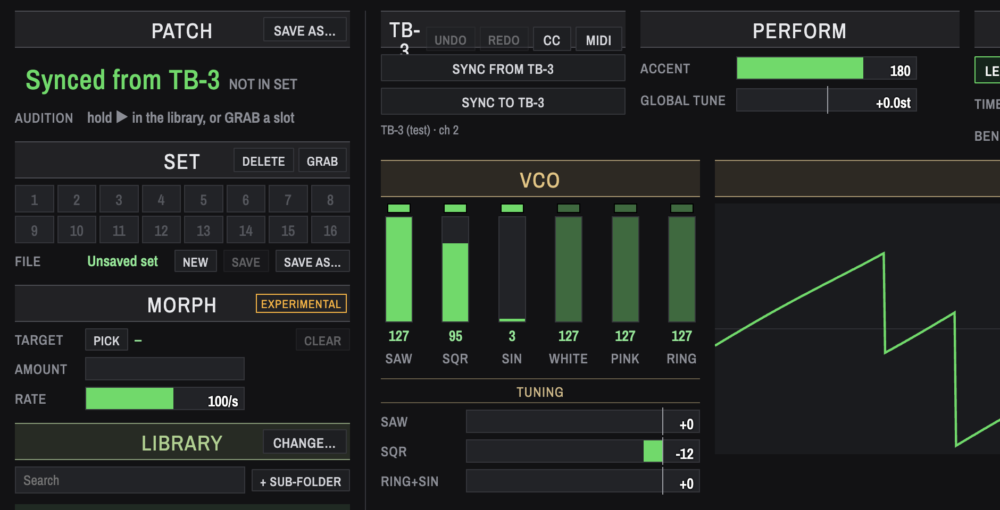 | 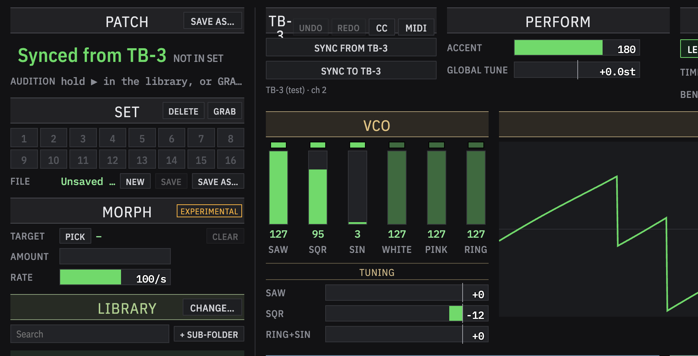 |

Options B, C and D each bundle their font and also include A's clean-up, described next.

#### A. Keep DIN Condensed and tidy it up

- One set of font variables shared by both apps (`--font-panel`, `--font-text`, `--font-mono`) and a short type scale
  (for example 11 / 12 / 14 / 18 / 26px), so no more half-pixel sizes.
- Nothing on the SP-404 below 11px; the knob labels, `EXP`, group titles and preset numbers go up.
- The FX graph labels switch to the panel font, so each app uses one family on its panels.
- `tabular-nums` wherever numbers change.
- No new dependency and no change in look. It stays Mac-only (Windows builds fall back to Arial), and there is still
  only one weight.

#### B. Barlow Condensed: keeps the DIN look

- [Barlow](https://github.com/jpt/barlow) (Jeremy Tribby, OFL) is drawn in the DIN / road-sign style, so the apps keep
  the look they have now. It is the closest fit to today's metrics: the only overflow is the TB-3's EFX1 type row,
  where EQ wraps onto a second line.
- Several weights: 500 for labels, 600 for values, headings and buttons.
- Its figures are proportional by default, so the apps would set `font-variant-numeric: tabular-nums` (the subset
  keeps that feature; measured). Its tabular digits are a little wider than DIN's.

#### C. Roboto Condensed: the Univers-style option (recommended if Univers is the look you want)

- The open font closest to Univers Condensed, and so closest to the SP-404's own panel. It reads more evenly than
  DIN at small sizes, and its figures are tabular already.
- About 10% wider than DIN Condensed. Most of both apps fit as they are. In the samples, the TB-3 EFX type rows wrap
  "PITCH SHIFT / EQ" and "REVERB" onto a second line, and the SP-404 Super Filter's TYPE buttons cut off "LOW-PAS…".
  Those few places would be fixed (tighter padding or tracking) when applying.
- **C′, Archivo Narrow**, fits in the same way, with the same few places to fix. It has a slightly warmer, less
  "engineered" look than Roboto.

#### D. IBM Plex Sans Condensed, with Plex Mono for readouts

- [IBM Plex](https://github.com/IBM/plex) (OFL). It is the easiest to read at small sizes, and monospaced readouts
  look like instrument displays.
- About 15% wider than DIN Condensed, and Plex Mono is wider still. "TB-3" wraps in its header, "Unsaved set" and
  "BANK VOL" are cut short, the filter type reads "LOW-PAS", and the EFX rows wrap. Both layouts would need rework,
  and the apps would look more "IBM", less "Roland".

### Decision (2026-11-14)

**SP-404: Archivo**, for now; the TB-3 stays on DIN Condensed until we come back to it.

- It is bundled from `@fontsource-variable/archivo` (SIL OFL 1.1; the licence ships in the package and in `dist/`)
  and set up in `apps/sp404/src/type.css`.
- It uses the variable Archivo at 75% width rather than the static Archivo Narrow from the samples. The design is the
  same, a touch narrower, but the variable font has tabular figures, which the static Archivo Narrow lacks (measured:
  its "1" is narrower than its "0" even with `tabular-nums`).
- Labels and text are at weight 500; values, readouts and bus names at 600. `word-spacing: 0.12em` keeps spaces
  visible at this width. The FX graph labels now use the panel font instead of SF Pro.
- The only overflow was the Super Filter's three TYPE buttons (about 40px each), which drop to 62% width.
- Still to do once the BCR2000 work in `styles.css` is committed: move the font rules into `styles.css`, replace the
  half-pixel sizes with a type scale, and raise the smallest text (9–10px) to 11px. The spectrum labels drawn on
  canvas (`packages/audio`, shared with the TB-3) are still DIN.

## Next topics

Open topics for the review, in a suggested order:

1. **Colour**: the two palettes (TB-3 green, SP-404 orange and per-bus colours), how readable grey on dark is (`--dim`
   on `--panel`), how well state colours (on, armed, mute, solo, error) stand out, and colour-blind safety of the
   bus colours.
2. **Spacing and density**: padding and gaps between sections, how controls line up, empty space (the SP-404's
   right-hand mixer area, the TB-3's lower right).
3. **Layout**: what is where in each app, the fixed design sizes and `zoom`, and what happens on other aspect ratios.
4. **Controls**: how faders, knobs, segmented buttons and dropdowns look and behave, how big their hit areas are,
   and hover / focus / active states.
5. **Consistency between the apps**: shared control styles and tokens, which could move into a shared package.
6. **Icons and symbols**: the arrows, ▶, ●, · and → used as glyphs.
